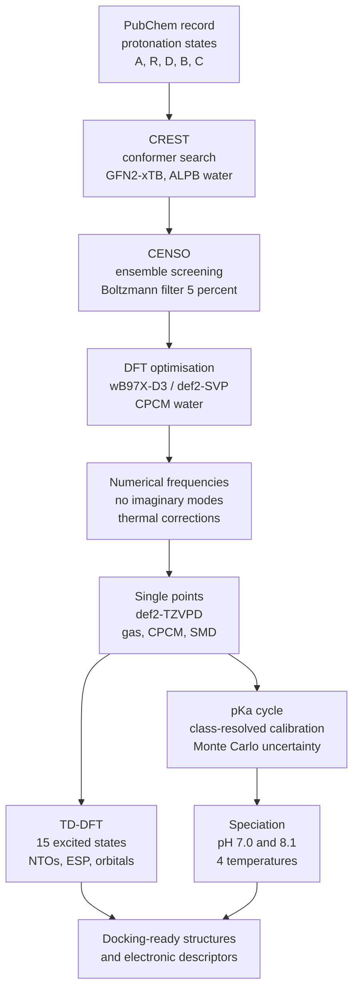

# MAA Quantum-Chemical Protocol (`maaqc`)

**Getting the molecule right before asking what it does.** This is a calibrated, automated
quantum-chemistry protocol that assigns physically justified 3D structures, protonation states
and electronic properties to *mycosporine-like amino acids* (MAAs), the natural UV filters of
marine algae.


-orange)

> **Manuscript (in preparation, *Marine Drugs*, MDPI):**
> *Protonation state and conformational ensemble in mycosporine-like amino acids: a calibrated
> quantum-chemical protocol.* Camilo Zúñiga Jara et al.

---

## In plain language

Red algae living under intense sunlight (including in Antarctica) make small molecules called
**MAAs** that absorb ultraviolet light and release it harmlessly as heat. They work as natural
sunscreens. Recent studies have also proposed them as drugs. These studies used computer
simulations ("molecular docking") to test whether MAAs fit into human proteins such as the
ACE2 receptor used by SARS-CoV-2.

Those docking studies took the molecule's shape from a public database drawing. That raises two
questions they did not test:

1. **Which shape does the molecule actually adopt in water?** A flexible molecule has many
   possible 3D shapes (conformers), and the database drawing is only one of them.
2. **Where are its protons?** MAAs have several acidic and basic groups. At body pH some of
   them lose or gain a proton, and this changes the molecule's electric charge. The charge
   largely determines how a molecule binds to a protein. Experiments have shown that the form
   of the molecule that absorbs UV at physiological pH is a charged one, not the neutral form
   stored in databases. A simulation that uses the wrong protonation state is, strictly
   speaking, modelling a different molecule.

This project builds a reproducible pipeline that answers both questions from first principles
(quantum mechanics) instead of assuming the answers. It then computes the properties that
other researchers need as inputs: the UV absorption spectrum, the electrostatic surface and the
frontier orbitals. The pipeline is applied to **nine MAAs plus their biosynthetic precursor
4-deoxygadusol**, at four temperatures that include the Antarctic surface ocean (274 K).

The whole protocol runs on **a single laptop**. Making that possible was a design goal in
itself, and a large part of the engineering went into it.

---

## The scientific gap

| What earlier work did | What this protocol does instead |
|---|---|
| 2D database record → 3D by a file converter or force field | Systematic conformational search (CREST metadynamics) followed by DFT optimisation |
| One structure per molecule | A Boltzmann-weighted **ensemble** of conformers, verified as true minima by vibrational frequencies |
| Protonation state assumed or taken from the database | Protonation state **computed** from a thermodynamic pKa cycle, calibrated against reference compounds |
| pKa quoted as a single number ("±1–2 units") | Calibration **by transition class**, with Monte Carlo uncertainty propagated through the whole protonation chain |
| Single temperature | 250 K, 274.15 K (Antarctic ocean), 298.15 K (standard), 310 K (human body) |

To our knowledge, no previous study has assigned the protonation state of an MAA through a
quantum-mechanical free-energy calculation.

---

## The pipeline



| Stage | Method | Software |
|---|---|---|
| 1. Conformational sampling | iMTD-GC, GFN2-xTB, ALPB(water) | CREST 3.0.2 / xTB 6.7.1 |
| 2. Ensemble refinement | Pre-screening + screening, Boltzmann selection (5 %, min. 3 conformers) | CENSO 3.0.9 |
| 3. Geometry optimisation | ωB97X-D3/def2-SVP, CPCM(water), RIJCOSX, TightOpt | ORCA 6.1.1 |
| 4. Frequency verification | Numerical frequencies; harmonic and quasi-harmonic (Grimme, 100 cm⁻¹) free energies | ORCA, GoodVibes |
| 5. Single-point energies | ωB97X-D3/def2-TZVPD, gas phase, CPCM(water) and SMD(water) | ORCA |
| 6. Excited states | Full linear-response TD-DFT (no TDA), 15 roots, natural transition orbitals, CD | ORCA, orca_plot |
| 7. Surface analysis | Electrostatic potential on the 0.001 a.u. isodensity surface | Multiwfn |
| — pKa and speciation | Thermodynamic cycle over conformer ensembles, class-resolved calibration, Monte Carlo | `maaqc.py pka` / `calibrate` |

The full methods (equations, keyword lines, calibration rules and uncertainty model) are in
[docs/METHODS.md](docs/METHODS.md).

---

## What has come out of it so far

The quantitative results (absorption maxima, pKa values, speciation) are being tabulated for
the manuscript, so they are deliberately not quoted here. Three methodological findings are
already firm.

**1. One global pKa correction gives wrong answers for different transition types, in
opposite ways.**
The protocol was calibrated against aspartic acid, glutamic acid, glycine, valine and
4-aminopyridine, grouped by *type* of deprotonation. The same cycle at the same level of
theory reproduces first-carboxyl deprotonations closely. For an ammonium group flanked by two
carboxylates (glutamic acid, −1 → −2) it misses by **about eight pKa units**. A single global
correction would average these two cases and be wrong for both. The pipeline therefore
calibrates per class and **refuses** to apply a calibrator across charge classes unless the
user explicitly overrides it. Three MAAs (shinorine, porphyra-334, mycosporine-glycine:valine)
have a related topology in their most deprotonated state, so this choice directly affects
their predicted speciation.

**2. A proton constant used in some published implementations shifted every pKa by about
+4.2 units.**
Some implementations of the continuum pKa cycle use −264.61 kcal/mol as the total free energy
of the proton in water. That value is a solvation free energy only: it leaves out the gas-phase
term and the standard-state correction. Tracking this down and assembling the constant from
its three physical components (−270.29 kcal/mol) removed a systematic error from the whole
project. With the corrected constant, the two cycle variants become algebraically identical,
which the pipeline uses as an implementation check.

**3. Every conformer converged.**
For all ten compounds and every protonation state, all dominant conformers selected by CENSO
converged through DFT optimisation, frequency verification, single points and TD-DFT. No
structure had to be discarded.

---

## Engineering: production software on a laptop

`maaqc.py` is a single 17,000-line Python program with six subcommands:

```text
maaqc.py run        computation stages (CREST → CENSO → OPT → FREQ → SP → TDDFT)
maaqc.py status     state of every run in the project
maaqc.py collect    results analysis, Boltzmann averaging, spectra, Excel export
maaqc.py pka        protonation cycle, speciation curves, Monte Carlo uncertainty
maaqc.py calibrate  class-resolved calibration against reference compounds
maaqc.py cubes      HOMO/LUMO and natural-transition-orbital cube extraction
```

Some design decisions that make a multi-week computational campaign survivable on one machine:

- **Resumable stages with a fingerprint.** Each ORCA job writes a `job.json` manifest with a
  hash of its normalised input and source geometry. Finished work is reused only if it matches.
  Stale outputs are flagged, archived (never overwritten) and recomputed on request.
- **Crash recovery.** Interrupted geometry optimisations restart from the last geometry and
  wavefunction. Interrupted CENSO pre-screening is rebuilt from partial output. Numerical
  frequency jobs resume from finished displacements.
- **Hardware-aware scheduling.** The pipeline reads the CPU topology of the hybrid
  performance/efficiency-core processor from `/sys`, pins each job to physically independent
  cores and derives cores, memory and concurrency per stage. A `flock`-protected lock file
  coordinates CPU reservations between pipeline instances running at the same time.
- **Clean process control.** Time-outs and Ctrl-C kill the whole process group, so MPI workers
  are not left orphaned. Long jobs are detached and keep running if the terminal closes.
- **Physics guard-rails in code.** Before any calculation, the pipeline checks that the charge
  and atom count of each pair of protonation states match the transition being modelled.
- **Tests.** [`test_maaqc.py`](test_maaqc.py) covers the parts where a silent bug costs hours of
  computing time or produces a wrong pKa: ORCA convergence detection, job manifests and
  resumption, CPU reservation, proton constants and caches. It runs against real ORCA outputs
  from this repository.

Hardware used for every calculation: Lenovo ThinkPad T14, Intel Core Ultra 7, 32 GB RAM,
512 GB SSD.

---

## Compound set

| Compound | Chromophore | N-substituents | Reported λmax (nm)* |
|---|---|---|---|
| 4-Deoxygadusol (precursor) | cyclohexenone | — | 268 (acidic) / ≈294 (basic) |
| Mycosporine-glycine | cyclohexenone | Gly | 310 |
| Palythine | cyclohexenimine | Gly; imine NH | 320 |
| Asterina-330 | cyclohexenimine | Gly; ethanolamine | 330 |
| Palythinol | cyclohexenimine | Gly; aminopropanol | 332 |
| Shinorine | cyclohexenimine | Gly; Ser | 332–334 |
| Porphyra-334 | cyclohexenimine | Gly; Thr | 332–334 |
| Mycosporine-glycine:valine | cyclohexenimine | Gly; Val | 335 |
| Usujirene (*cis*) | cyclohexenimine | Gly; N-propenyl | 356–357 |
| Palythene (*trans*) | cyclohexenimine | Gly; N-propenyl | 359–360 |

\*Literature values for orientation only. They are being traced to the primary measurements
together with solvent and pH, because most were recorded in acidified HPLC eluent, where the
predominant species can differ from the one at pH 7.

---

## Repository map

```text
.
├── maaqc.py              # the pipeline: run · status · collect · pka · calibrate · cubes
├── test_maaqc.py         # pytest suite
├── requirements.txt      # Python dependencies
├── docs/METHODS.md       # full computational methods
├── calibration/          # pKa calibration fits (JSON/CSV) and raw logs
├── CALIBRATIONS/         # reference amino acids used to calibrate the pKa cycle
│   └── <ASPARTIC|GLUTAMIC|GLYCINE|VALINE>/molecules/*.xyz
├── AP/                   # 4-aminopyridine (pyridinium calibrator), complete run record
├── DG/                   # 4-deoxygadusol, complete run record
├── MGLYVAL/              # mycosporine-glycine:valine (reference MAA of the project)
├── SHINORINE/ PORPHYRA-334/ PALYTHINE/ MGLY/ GADUSOL/   # starting geometries
├── QCG/                  # explicit-solvation test (CREST quantum cluster growth, water shell)
└── tools/                # archive/restore scripts for the storage workflow
```

Every molecule folder follows the same layout:

```text
<MOL>/
├── molecules/<label>.xyz         # one input geometry per protonation state
└── runs/<label>/
    ├── 01_crest/                 # conformer ensemble
    ├── 01b_censo_prescreen/      # CENSO screening summary
    ├── 02_opt/conf_N/            # DFT optimisation
    ├── 03_numfreq/conf_N/        # frequencies (.hess)
    ├── 04_sp/  04b_sp_gas/  04c_sp_smd/   # single points (CPCM, gas, SMD)
    ├── 05_tddft/conf_N/          # excited states
    └── pipeline.log              # full log of the run
```

**Protonation-state labels.** The last letter of each file name tells the pipeline the formal
charge: `A` cation (+1), `R` neutral (0), `D` zwitterion (0, a tautomer of R), `B` monoanion
(−1), `C` dianion (−2).

**Want to look at a real calculation?** Two examples:
[an optimisation](AP/runs/APR/02_opt/conf_1/opt.out) and
[a TD-DFT excited-state output](MGLYVAL/runs/B/05_tddft/conf_001/tddft.out).

### Data policy

Git holds the **scientific record**: inputs, text outputs, geometries, energies, Hessians and
result tables. Heavy binary scratch from ORCA/CREST/CENSO (wavefunctions, densities, per-conformer
CENSO sub-folders) is excluded by [`.gitignore`](.gitignore) and kept on two external drives
([`tools/archive_molecule.sh`](tools/archive_molecule.sh)). Compounds whose campaign is
finished are archived off the laptop. The complete set of optimised geometries and outputs will
be released as a versioned dataset with the manuscript.

---

## Running it

External programs (not pip-installable): ORCA 6.1.1, CREST 3.0.2, xTB 6.7.1, CENSO 3.0.9 and
Multiwfn (for ESP analysis).

```bash
pip install -r requirements.txt
python maaqc.py --help
python maaqc.py run --mol MGLYVAL/molecules/B.xyz --charge -1 --cores 8
python maaqc.py status
python maaqc.py collect --mol MGLYVAL --state B --export xlsx --plot
python maaqc.py pka --mol MGLYVAL --protonated A --neutral R --zwitterion D \
                    --anion B --dianion C --montecarlo --plot
pytest test_maaqc.py
```

Code comments and log messages are in Spanish. This README and the documentation are in
English.

---

## Limitations and the open problem

These limits are stated up front:

- **Implicit solvent.** A dielectric continuum cannot represent hydrogen bonds to first-shell
  water. The eight-unit pKa error above is one measurable consequence. The `QCG/` folder holds a
  first test with explicit water molecules.
- **Vertical, single-reference excited states.** TD-DFT predicts *where* a molecule absorbs,
  not how efficiently it turns that energy into heat.
- **The functional error has not been benchmarked yet.** The protonated MAA chromophore is
  cyanine-like, and TD-DFT is known to overestimate excitation energies systematically for
  such systems. The next step is a coupled-cluster (STEOM-DLPNO-CCSD) reference on a truncated
  chromophore model, validated against the full molecule. At the triple-zeta level this
  calculation is beyond what a laptop can run, which makes it the main resource bottleneck of
  the project.
- **Not yet run:** a direct comparison against structures rebuilt exactly as the published
  docking studies built them (ten single points). This comparison turns the paper's central
  argument into a measurement.

---

## Status

| Component | Status |
|---|---|
| Automated pipeline, all stages | ✅ Built and running |
| Conformer search, DFT optimisation, frequencies, single points, TD-DFT (10 compounds) | ✅ Done |
| Thermodynamic pKa cycle with unified proton reference | ✅ Implemented |
| Monte Carlo uncertainty (correlated proton error across the chain) | ✅ Implemented |
| Class-resolved calibration | 🔄 Framework built; calibration set being extended |
| ESP / orbital / NTO analysis | 🔄 Computed, being organised |
| Tabulation of results for the manuscript | 🔄 In progress |
| Comparison against database-derived structures | ⏳ Next |
| Wave-function benchmark (coupled cluster) | ⏳ Needs computing resources beyond a laptop |
| Re-docking with corrected structures | Follow-up project |

---

## Authorship

**Camilo Zúñiga Jara** designed the protocol, wrote the pipeline, ran all calculations and is
writing the manuscript. The work is done in collaboration with Dr. Ricardo Veloso (Universidad
de La Frontera) and Dr. Desmond Macleod (Universidad Autónoma, Santiago).

**Use of AI tools.** Parts of `maaqc.py` were written with the help of Claude Code (Anthropic).
All scientific choices, calculations and outputs were designed, reviewed and verified by the
author, who takes full responsibility for them. This follows the MDPI policy on generative AI.

## Citation

If you use this code, please cite it using [CITATION.cff](CITATION.cff) (GitHub's
"Cite this repository" button). A manuscript citation will be added on publication.

## License

[MIT](LICENSE)
