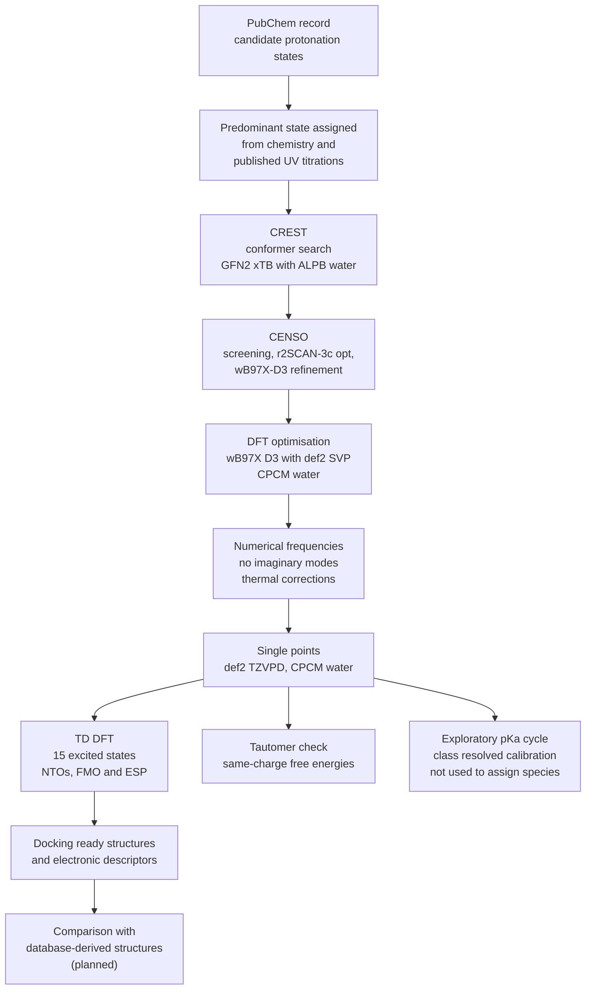

# MAA Quantum-Chemical Protocol (`maaqc`)

This repository contains an automated quantum-chemical workflow that builds solution-phase
conformational ensembles and electronic descriptors of *mycosporine-like amino acids* (MAAs),
the natural UV filters of marine algae, and prepares them as docking-ready reference
structures.


> **Manuscript (in preparation):**
> *Conformational ensembles, electronic descriptors and docking-ready structures of
> mycosporine-like amino acids from an automated quantum-chemical workflow.* Camilo Zúñiga
> Jara. The draft is not distributed through this repository; it is available from the author
> on request.

## Background

Red algae living under intense sunlight (including in Antarctica) produce small molecules
called MAAs, which absorb ultraviolet radiation and dissipate it as heat, and therefore act as
natural sunscreens. Recent studies have also proposed them as drug candidates. These studies
used computer simulations (molecular docking) to test whether MAAs bind human proteins such as
the ACE2 receptor used by SARS-CoV-2.

The docking studies took the molecular geometry from a public database drawing. This leaves two
questions open:

1. Which shape does the molecule adopt in water? A flexible molecule has many possible 3D
   shapes (conformers), and the database drawing is only one of them.
2. Where are its protons? MAAs have several acidic and basic groups, and at body pH some of
   them lose or gain a proton, which changes the molecule's electric charge. The charge largely
   determines how a molecule binds to a protein. Published UV titrations show which
   protonation state absorbs at physiological pH; this project uses that chemical and
   experimental evidence to assign the predominant species, checked against tautomers of the
   same charge, rather than deriving it from a calibrated computation.

This project implements a reproducible pipeline that builds a Boltzmann-weighted conformational
ensemble of the assigned species from first principles (quantum mechanics) and computes the
electronic properties that other researchers need as docking inputs: the UV absorption
spectrum, natural transition orbitals, frontier orbitals and the electrostatic surface. The
central, still-pending analysis compares the resulting structures and descriptors against
structures built the way the published docking studies built theirs. The pipeline covers nine
MAAs and their biosynthetic precursor 4-deoxygadusol spanning the family's reported absorption
range; the manuscript focuses on three of them — mycosporine-glycine:valine, shinorine and
4-deoxygadusol — at three temperatures (274.15 K, the Antarctic surface ocean; 298.15 K;
310 K, human body). It was designed to run on a single laptop.

The pipeline also implements a continuum thermodynamic pKa cycle with class-resolved
calibration. Because computed pKa values from continuum solvent models carry a general
uncertainty of several units (Ho & Coote, 2010; Ho, 2015), this cycle is not the route used to
assign the predominant species; it is kept as an exploratory, non-primary analysis (see
Methodological findings below).

## Comparison with previous approaches

| Previous work | This protocol |
|---|---|
| 2D database record → 3D by a file converter or force field | Systematic conformational search (CREST metadynamics) followed by DFT optimisation |
| One structure per molecule | A Boltzmann-weighted ensemble of conformers, verified as true minima by vibrational frequencies |
| Protonation state assumed or taken from the database | Predominant state assigned from the chemistry of the ionizable groups and published UV titrations, checked against same-charge tautomers |
| Ligand geometry taken directly from the database record | Boltzmann-weighted DFT ensemble, compared against a structure built and minimised the way the docking studies built theirs (planned central analysis) |
| Single temperature | 274.15 K (Antarctic surface ocean), 298.15 K (standard), 310 K (human body) |

To our knowledge, no previous computational study of MAAs has applied systematic
conformational sampling before DFT optimisation, or reported ground-state electronic
descriptors from protocol-validated, solution-phase geometries in a form the docking community
could adopt directly.

## Computational workflow



| Stage | Method | Software |
|---|---|---|
| 1. Conformational sampling | iMTD-GC, GFN2-xTB, ALPB(water) | CREST 3.0.2 / xTB 6.7.1 |
| 2. Ensemble refinement | Pre-screening B97-D3 + ALPB; screening and optimization r²SCAN-3c/CPCM; refinement ωB97X-D3/def2-TZVP/SMD; Boltzmann selection (5 %, min. 3 conformers) from r²SCAN-3c geometries | CENSO 3.0.9 |
| 3. Geometry optimisation | ωB97X-D3/def2-SVP, CPCM(water), RIJCOSX, TightOpt | ORCA 6.1.1 |
| 4. Frequency verification | Numerical frequencies; harmonic and quasi-harmonic (Grimme, 100 cm⁻¹) free energies | ORCA, GoodVibes |
| 5. Single-point energies | ωB97X-D3/def2-TZVPD, CPCM(water) | ORCA |
| 6. Excited states | Full linear-response TD-DFT (no TDA), 15 roots, natural transition orbitals, CD | ORCA, orca_plot |
| 7. Surface analysis | Electrostatic potential on the 0.001 a.u. isodensity surface | Multiwfn |
| Optional: same-charge tautomer check | Relative free energy between tautomers of equal charge and atom count, no proton reference constant | `maaqc.py pka` |
| Optional, exploratory: pKa cycle | Thermodynamic cycle over conformer ensembles, class-resolved calibration, Monte Carlo; not used to assign the predominant species | `maaqc.py pka` / `calibrate` |
| Planned | Compare docking-ready structures and descriptors against a structure built and minimised the way published docking studies built theirs | not yet in this repository |

The full methods (equations, keyword lines, calibration rules and uncertainty model) are in
[docs/METHODS.md](docs/METHODS.md).

## Methodological findings to date

The predominant protonation state of each MAA is assigned from the chemistry of its ionizable
groups and from published UV titrations (see Compound set below), not from the pKa cycle. That
cycle is kept in the pipeline as an exploratory, non-primary check, because computed pKa values
from continuum solvent models carry a general uncertainty of two to three units (Ho & Coote,
2010; Ho, 2015). Two methodological findings from building and testing it are already
established; the quantitative results on the MAAs themselves (absorption maxima, electronic
descriptors, comparison with database-derived structures) are still being produced and are
therefore not quoted here.

### A single global pKa correction is inadequate across transition types

The cycle was tested against aspartic acid, glutamic acid, glycine, valine and
4-aminopyridine, grouped by type of deprotonation. The same cycle at the same level of theory
reproduces first-carboxyl deprotonations closely, but for an ammonium group flanked by two
carboxylates (glutamic acid, −1 → −2) it overshoots by several pKa units. A single global
correction would average these two cases and be wrong for both, so the exploratory cycle
calibrates per transition class rather than applying one correction across charge classes.

### The proton constant in some published implementations shifts every pKa by about +4.2 units

Some implementations of the continuum pKa cycle use −264.61 kcal/mol as the total free energy
of the proton in water. That value is a solvation free energy only: it omits the gas-phase term
and the standard-state correction. Assembling the constant from its three physical components
(−270.29 kcal/mol) removes this systematic error. With the corrected constant, two equivalent
formulations of the cycle become algebraically identical, which the pipeline uses as an
implementation check.

## Implementation

`maaqc.py` is a single 16,000-line Python program with six subcommands:

```text
maaqc.py run        computation stages (CREST → CENSO → OPT → FREQ → SP → TDDFT)
maaqc.py status     state of every run in the project
maaqc.py collect    results analysis, Boltzmann averaging, spectra, Excel export
maaqc.py pka        protonation cycle, speciation curves, Monte Carlo uncertainty
maaqc.py calibrate  class-resolved calibration against reference compounds
maaqc.py cubes      HOMO/LUMO and natural-transition-orbital cube extraction
```

`pka` and `calibrate` implement a full, class-resolved, calibrated protonation-state cycle. In
the manuscript this cycle is kept as an exploratory, non-primary analysis (see Methodological
findings above): the predominant protonation state of each MAA is assigned from chemistry and
published UV titrations, not computed from this cycle.

The following design decisions allow a multi-week computational campaign to run on one machine.

- *Resumable stages with a fingerprint.* Each ORCA job writes a `job.json` manifest with a
  hash of its normalised input and source geometry. Finished work is reused only if it matches.
  Stale outputs are flagged, archived (never overwritten) and recomputed on request.
- *Crash recovery.* Interrupted geometry optimisations restart from the last geometry and
  wavefunction. Interrupted CENSO pre-screening is archived and repeated. Numerical frequency
  jobs resume from finished displacements.
- *Hardware-aware scheduling.* The pipeline reads the CPU topology of the hybrid
  performance/efficiency-core processor from `/sys`, pins each job to physically independent
  cores and derives cores, memory and concurrency per stage. A `flock`-protected lock file
  coordinates CPU reservations between pipeline instances running at the same time.
- *Process control.* Time-outs and Ctrl-C kill the whole process group, so MPI workers
  are not left orphaned. Long jobs are detached and keep running if the terminal closes.
- *Physics checks in code.* Before any calculation, the pipeline checks that the charge
  and atom count of each pair of protonation states match the transition being modelled.
- *Tests.* [`test_maaqc.py`](test_maaqc.py) covers the parts where a silent bug costs hours of
  computing time or produces a wrong pKa: ORCA convergence detection, job manifests and
  resumption, CPU reservation, proton constants and caches. It runs against real ORCA outputs
  from this repository.

Hardware used for every calculation: a single laptop with 32 GB RAM.

## Compound set

The pipeline covers nine MAAs and their biosynthetic precursor 4-deoxygadusol, spanning the
family's reported absorption range. The manuscript focuses on three of
them — mycosporine-glycine:valine, shinorine and 4-deoxygadusol — whose protonation states,
conformational ensembles and spectroscopic analysis are most advanced; the remaining compounds
situate this subset within the family.

| Compound | Chromophore | N-substituents | Reported λmax (nm)* |
|---|---|---|---|
| 4-Deoxygadusol (precursor) | cyclohexenone | — | 268 (acidic) / ≈294 (basic) |
| Mycosporine-glycine | cyclohexenone | Gly | 310 |
| Palythine | cyclohexenimine | Gly; imine NH | 320 |
| Asterina-330 | cyclohexenimine | Gly; ethanolamine | 330 |
| Palythinol | cyclohexenimine | Gly; aminopropanol | 332 |
| Shinorine | cyclohexenimine | Gly; Ser | 332–334 |
| Porphyra-334 | cyclohexenimine | Gly; Thr | 332–334 |
| Mycosporine-glycine:valine | cyclohexenimine | Gly; Val | 335 |
| Usujirene (*cis*) | cyclohexenimine | Gly; N-propenyl | 356–357 |
| Palythene (*trans*) | cyclohexenimine | Gly; N-propenyl | 359–360 |

\*Literature values for orientation only. They are being traced to the primary measurements
together with solvent and pH, because most were recorded in acidified HPLC eluent, where the
predominant species can differ from the one at pH 7.

## Repository structure

```text
.
├── maaqc.py              # the pipeline: run · status · collect · pka · calibrate · cubes
├── test_maaqc.py         # pytest suite
├── censo2rc_refine      # CENSO four-stage settings (set the ORCA/xTB paths)
├── requirements.txt      # Python dependencies
├── docs/METHODS.md       # full computational methods
├── calibration/          # pKa calibration fit (calibration_v4.json)
└── AP/runs/APR/          # 4-aminopyridine ORCA outputs (optimisation, frequencies) used by the tests
```

Every molecule folder follows the same layout:

```text
<MOL>/
├── molecules/<label>.xyz         # one input geometry per protonation state
└── runs/<label>/
    ├── 01_crest/                 # conformer ensemble
    ├── 01b_censo_prescreen/      # CENSO screening summary
    ├── 02_opt/conf_N/            # DFT optimisation
    ├── 03_numfreq/conf_N/        # frequencies (.hess)
    ├── 04_sp/  04b_sp_gas/  04c_sp_smd/   # single points (CPCM, gas, SMD)
    ├── 05_tddft/conf_N/          # excited states
    └── pipeline.log              # full log of the run
```

### Protonation-state labels

The last letter of each file name tells the pipeline the formal charge: `A` cation (+1), `R` neutral (0), `D` zwitterion (0, a tautomer of R), `B` monoanion
(−1), `C` dianion (−2).
Any other ending is not guessed: without `--charge` the run stops with an error asking for it.

Representative output files:
[an optimisation](AP/runs/APR/02_opt/conf_1/opt.out) and
[a numerical-frequency output](AP/runs/APR/03_numfreq/conf_1/freq.out).

### Data policy

This repository contains the code, the methods, the calibration and the two ORCA outputs used
by the tests. The data of each molecule are kept in private storage. The complete set of
optimised geometries and outputs will be released as a versioned dataset with the manuscript.

## Usage

External programs (not pip-installable): ORCA 6.1.1, CREST 3.0.2, xTB 6.7.1, CENSO 3.0.9 and
Multiwfn (for ESP analysis).

```bash
pip install -r requirements.txt
python maaqc.py --help
python maaqc.py run --mol MGLYVAL/molecules/B.xyz --charge -1 --cores 8
python maaqc.py status
python maaqc.py collect --mol MGLYVAL --state B --export xlsx --plot
python maaqc.py pka --mol MGLYVAL --protonated A --neutral R --zwitterion D \
                    --anion B --dianion C --montecarlo --plot
# pka and calibrate default to the primary protocol (SMD, qh-GoodVibes); pka: --no-spsmd / --no-goodvibes, calibrate: --no-spsmd / --gcorr harmonic for sensitivity runs
pytest test_maaqc.py
```

Code comments and log messages are in Spanish. This README and the documentation are in
English.

## Limitations

- *Implicit solvent.* A dielectric continuum cannot represent hydrogen bonds to first-shell
  water. The several-pKa-unit error of the exploratory cycle described above is one measurable
  consequence.
- *Vertical, single-reference excited states.* TD-DFT predicts where a molecule absorbs, but
  not how efficiently it converts that energy into heat.
- *Partial benchmarking of the functional error.* The protonated MAA chromophore is
  cyanine-like, and TD-DFT is known to overestimate excitation energies systematically for
  such systems. Wave-function reference calculations are in progress; at the triple-zeta level
  the remaining calculations are beyond what a laptop can run comfortably, which makes them
  the main resource bottleneck.
- *Protonation state is assigned, not calculated.* The predominant species follows from the
  chemistry of the ionizable groups and from published evidence, checked against same-charge
  tautomers, rather than from a calibrated free-energy cycle.
- *Not yet run.* A direct comparison against structures rebuilt exactly as the published
  docking studies built them. This comparison would provide a quantitative test of the
  central argument of the paper.

## Status

| Component | Status |
|---|---|
| Conformer sampling (CREST/CENSO), DFT optimisation, frequencies, CPCM single points | Implemented |
| TD-DFT excited states, natural transition orbitals, frontier orbitals (`cubes`) | Implemented |
| Electrostatic potential surface analysis via Multiwfn (`collect --esp`) | Implemented |
| Same-charge tautomer free-energy check | Implemented (via the ensemble free energies; no dedicated calibration) |
| Exploratory, class-resolved pKa cycle and calibration framework | Implemented; specification frozen at tag `pka-spec-v1.1`; kept as a non-primary check |
| Temperature reweighting of ensembles (GoodVibes, three temperatures) | Implemented |
| pH scan against published titrations | Planned, as an analysis of already-computed protonation states |
| Docking-ready structure export and comparison with database-derived structures | Planned, not yet in this repository |
| Production calculations on the full compound set | In progress |
| Manuscript | In preparation |

## Authorship

Camilo Zúñiga Jara designed the protocol, wrote the pipeline, ran all calculations and is
writing the manuscript. Co-authors are not yet defined.

Acknowledgements. Dr. Ricardo Veloso (Universidad de La Frontera) and Dr. Desmond Macleod
(Universidad Autónoma, Santiago) provided guidance and support as advising professors; they
are not co-authors of this work.

Use of AI tools. Parts of `maaqc.py` were written with the help of Claude Code (Anthropic).
All scientific choices, calculations and outputs were designed, reviewed and verified by the
author, who takes full responsibility for them. This follows the MDPI policy on generative AI.

## Citation

If you use this code, please cite it using [CITATION.cff](CITATION.cff) (GitHub's
"Cite this repository" button). A manuscript citation will be added on publication.

## License

[MIT](LICENSE)
